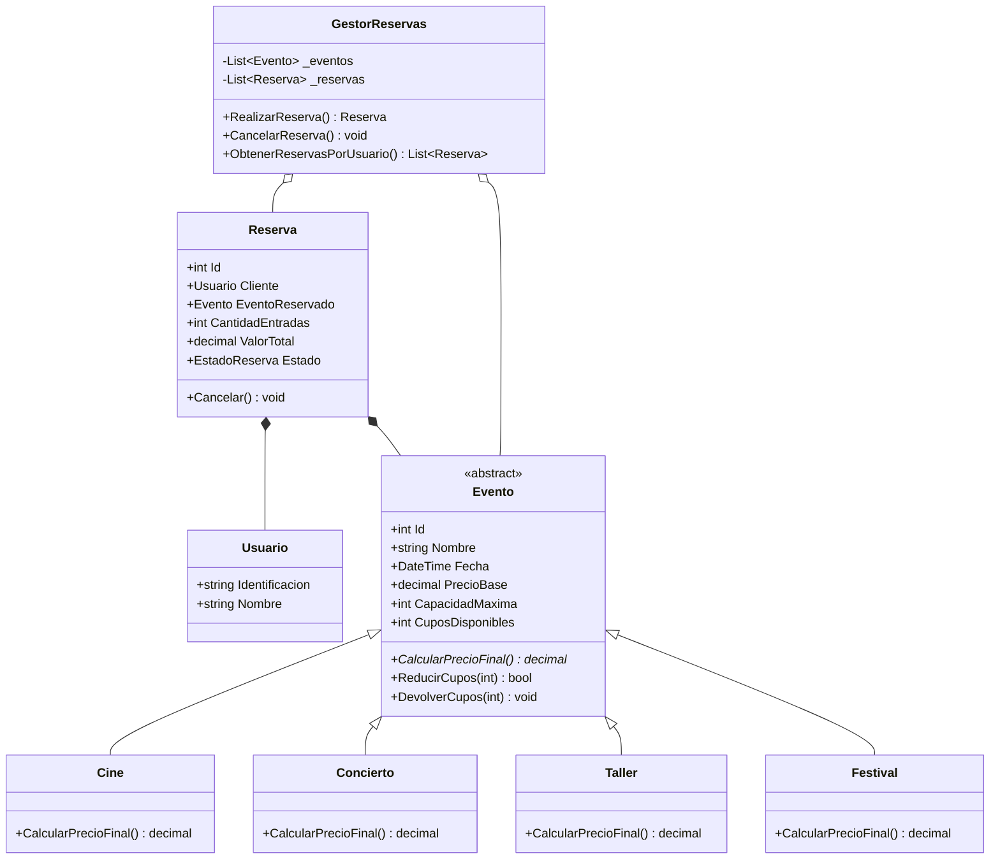
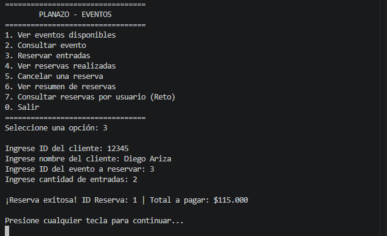
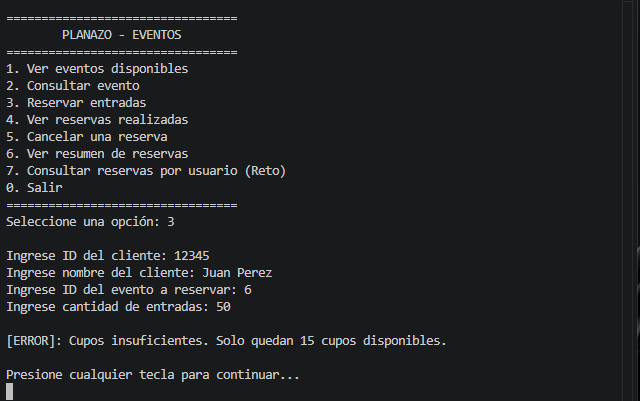
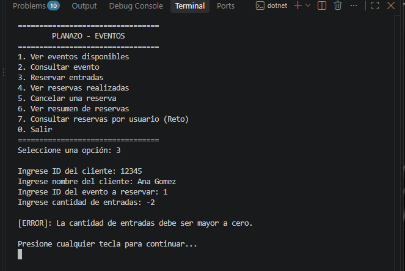
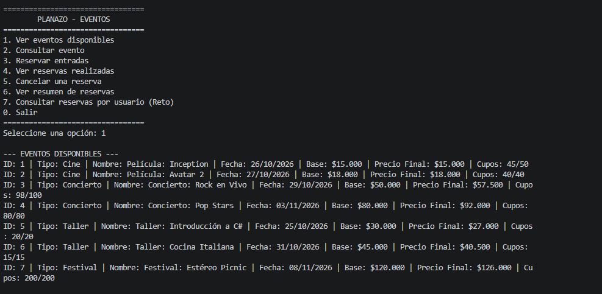
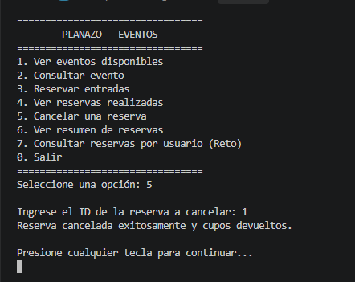
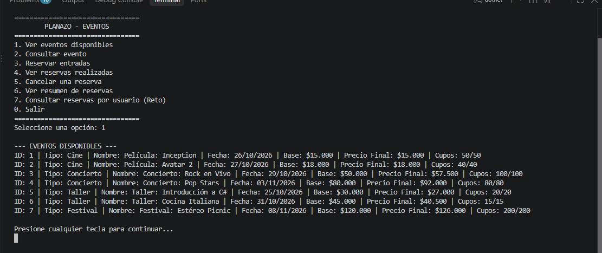
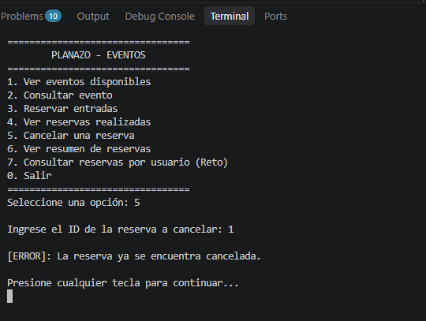
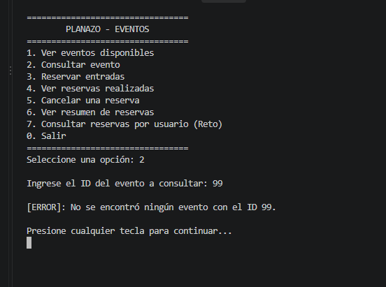
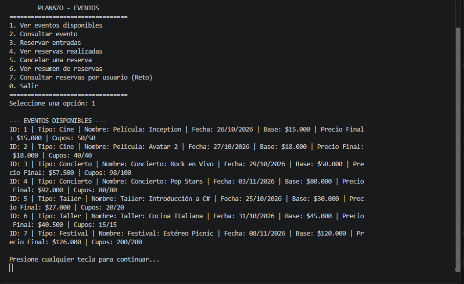

# PLANAZO - Sistema de Gestión de Eventos y Reservas

## Descripción
PLANAZO es una aplicación de consola desarrollada en C# y .NET para gestionar actividades de entretenimiento, consultar disponibilidad, realizar reservas y cancelarlas, aplicando los principios de Programación Orientada a Objetos (POO).

## Requisitos e Instrucciones de Ejecución
- **Plataforma:** .NET 10 SDK
- **Instrucciones:**
  1. Clonar el repositorio:
     ```bash
     git clone https://github.com/diegoprograma/PLANAZO-POO-CSharp.git
     ```
  2. Navegar al directorio e iniciar el proyecto:
     ```bash
     cd PLANAZO-POO-CSharp
     dotnet run
     ```

---

## Diagrama de Clases UML (Reto Adicional 3)



---

## Conceptos de POO Aplicados

- **Abstracción:** Se definió la clase abstracta `Evento`, que encapsula las características generales de cualquier evento y declara el método abstracto `CalcularPrecioFinal()`.
- **Herencia:** Las clases `Cine`, `Concierto`, `Taller` y `Festival` heredan de `Evento`, reutilizando sus propiedades y comportamientos de gestión de cupos.
- **Polimorfismo:** Cada clase derivada sobrescribe `CalcularPrecioFinal()` aplicando su lógica de precios (Cine: base, Concierto: +15%, Taller: -10%, Festival: +5%).
- **Encapsulamiento:** Las propiedades utilizan modificadores de acceso restringidos (`private set`) y los estados internos (como cupos disponibles) solo se modifican mediante métodos controlados (`ReducirCupos`, `DevolverCupos`).
- **Colecciones y Excepciones:** Manejo de datos dinámicos mediante `List<T>` y control de flujos erróneos mediante bloques `try-catch` y excepciones personalizadas.

---

## Pregunta de Sustentación

**¿Por qué utilizaste una clase abstracta `Evento` en lugar de crear clases completamente independientes para Cine, Concierto y Taller? ¿Qué ventajas tiene esta decisión cuando necesitamos agregar un nuevo tipo de evento?**

**Respuesta:**
Se utilizó una clase abstracta `Evento` para aplicar los principios de abstracción y reutilización de código. Dado que todos los eventos comparten propiedades comunes (`Id`, `Nombre`, `PrecioBase`, `CuposDisponibles`) y métodos compartidos (`ReducirCupos`, `DevolverCupos`), definirlos en una clase base evita la duplicación innecesaria de lógica.

La ventaja principal radica en la extensibilidad basada en el principio Abierto/Cerrado (Open/Closed Principle). Cuando agregamos un nuevo tipo de evento (como la clase `Festival` desarrollada en el Reto Adicional 1), solo creamos la nueva subclase sobrescribiendo `CalcularPrecioFinal()`. El gestor de reservas y la interfaz consumen objetos del tipo base `Evento` mediante **polimorfismo**, por lo que **no fue necesario modificar la lógica existente del sistema para integrar el nuevo tipo de evento**.

---

## Evidencias de Funcionamiento y Casos de Prueba

### 1. Registrar una reserva válida


### 2. Intentar reservar más entradas que los cupos disponibles


### 3. Intentar realizar una reserva con cantidad negativa o cero


### 4. Cancelar una reserva y comprobar devolución de cupos
- **Estado inicial de cupos:**
  
- **Confirmación de cancelación:**
  
- **Verificación de devolución de cupos:**
  

### 5. Intentar cancelar la misma reserva por segunda vez


### 6. Consultar un evento inexistente


### 7. Comprobar cálculo de precio final según el tipo de evento
